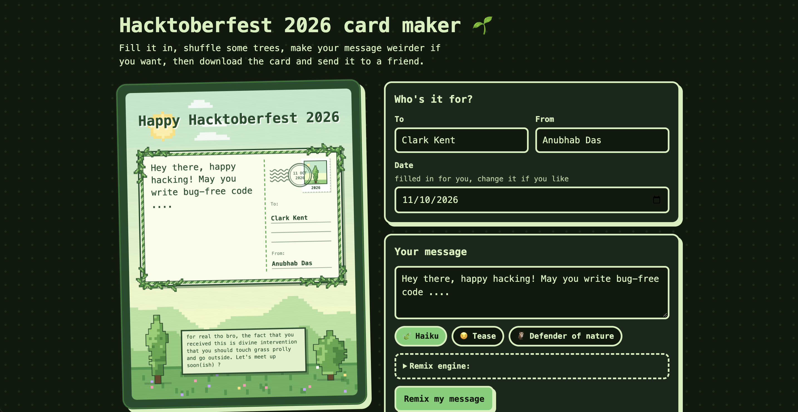
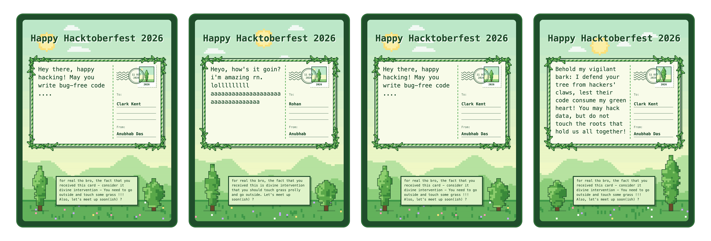

# hacktoberfest-card-maker-2026

Hacktoberfest E-Card Maker, 2026 edition, is a playful pixel-art e-card generator for sending a personal note to a friend, with a randomly generated nature scene, trees and vines unique to every card. You can write your own message or remix it into a haiku, a bit of teasing, or a “defender of nature” proclamation, using Ollama. Because the rewrite can run on a local open-weights model like Qwen3.5:2B, your text can stay on your machine, and you can download the finished card as a PNG.

Read more on my [dev.to blog post](https://dev.to/anubhabdaserrr/send-a-cute-nature-themed-old-timey-pixel-art-card-to-fellow-hacktoberfest-2026-participants-39k5) for Hacktoberfest Week 1 submission.

## What the webapp looks like:

## A couple sample e-cards:

